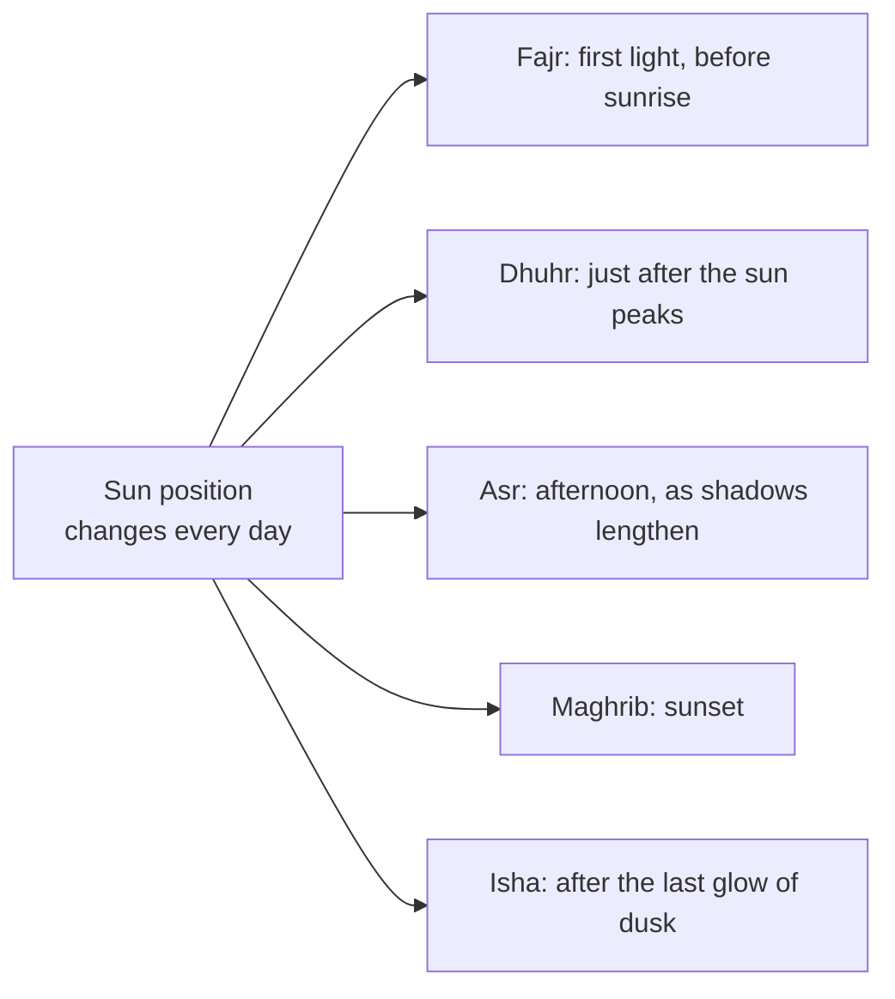
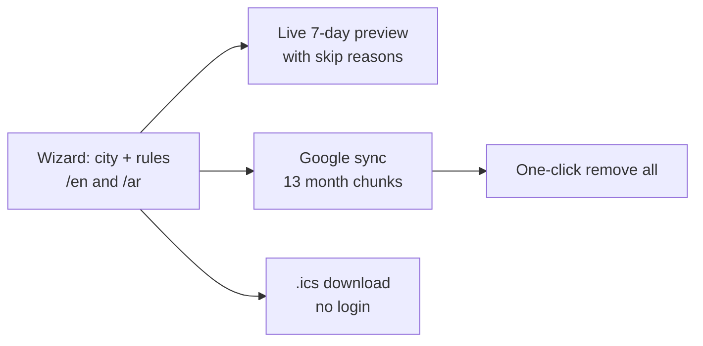

# salat-calendar

Turn a full year of prayer times into real Google Calendar events — or a downloadable `.ics` file. One pass, your own rules, one-click removal.

Open source under the Apache-2.0 licence. Part of the [hijri-js](https://github.com/hijri-js) family.

---

## What is Salat?

Salat is the five daily prayers in Islam. Their times are not fixed clock times — they follow the sun. Each prayer is tied to a position of the sun in the sky, so the time shifts a few minutes every day and drifts by hours across a year.



The same day, drawn as a sun arc:

```text
 sun elevation
      |
      |              * Dhuhr (sun at its highest)
      |          *         *
      |      *                 * Asr (afternoon)
      |   * Fajr (dawn)             *
      | *                               * Maghrib (sunset)
      +--------------------------------------- time
      dawn      morning     noon    afternoon   sunset
                                       Isha comes after dark: the sun plays no part
```

That is why a normal calendar event that repeats daily at 12:30 is wrong within a week. salat-calendar computes the true time for every day of the year.

## How it works



- A wizard collects a city (Open-Meteo search or GPS) and a few rules: which prayers, which days, offset, duration, rounding, a time window, Friday (Jummah) handling, and out-of-office skipping.
- Prayer times come from the AlAdhan API, cached 30 days, with a local `adhan` library fallback.
- The `prayer-engine` is a set of pure functions, shared by the browser (preview, `.ics`) and the server (Google sync). The server never trusts client times.
- Google sync writes month by month, paced by your browser. Every event is tagged `app=salat-calendar`, so re-syncing is safe and "Remove all" touches only our events.
- The Google access token lives in browser memory for the open tab only. It is never stored — no cookies, no `localStorage`, no server, no logs, no refresh token.
- No database. Your rules stay in your browser. Event ownership lives on the event tags.

## Setup

### Prerequisites

- Node 24 or newer
- pnpm (this project uses pnpm only — please never generate `package-lock.json` or `yarn.lock`)
- git

### Install and run

```bash
git clone https://github.com/hijri-js/salat-calendar.git
cd salat-calendar
pnpm install
cp .env.example .env.local
pnpm dev
```

The wizard and the live preview work without any Google setup. The `.ics` builder exists and is tested; the download button arrives in a later PR. The Google sync additionally needs a client ID (next section).

### Google client ID (only needed for the sync)

1. Open [console.cloud.google.com](https://console.cloud.google.com), create a project named `salat-calendar`.
2. **APIs & Services → Library** → enable the **Google Calendar API**.
3. **Google Auth Platform**: set up branding (app name `salat-calendar`, your support email), audience type **External**, status **Testing**, and add your own Gmail as a **test user**.
4. **Data access**: add the scopes `calendar.app.created`, `calendar.events.readonly`, and `calendar.events`.
5. **Clients → Create client** → type **Web application** → under **Authorized JavaScript origins** add `http://localhost:3000`. Leave redirect URIs empty.
6. Copy the **Client ID** into `.env.local`:

```bash
NEXT_PUBLIC_GOOGLE_CLIENT_ID=your-client-id.apps.googleusercontent.com
```

**Why there is no client secret.** Sign-in uses the Google Identity Services token popup. The browser gets an access token directly from Google; our server only forwards it per request and forgets it. No secret is ever exchanged, so there is none to save or leak. The client ID is public by design — it ships in the page.

Until Google verifies the app, sign-in is limited to the test users you listed (100 users in total for an unverified app). The preview works for everyone, and so will the `.ics` download once its button lands.

## Development

```bash
pnpm dev          # start the dev server
pnpm lint         # ESLint
pnpm test         # Vitest with coverage
pnpm build        # production build
```

TypeScript is strict. Routes live under `src/app/` (routing only). Feature code sits together in `src/features/<feature>/`, and shared framework-free logic in `src/lib/`. The UI uses Tailwind CSS v4, native HTML elements, and Lucide icons (see [ADR 0001](docs/adr/0001-native-ui-over-shadcn.md)), with `next-intl` for English (`/en`) and Arabic (`/ar`, right-to-left).

## Tests

Tests use Vitest. `src/lib/prayer-engine/` holds pure functions only — no I/O, no framework imports — and CI enforces a **100% coverage gate** (lines, branches, and functions) on that folder (a placeholder exercises the gate until the engine lands). The convention for the rest of the codebase: fixtures and unit tests where it matters — cache behaviour, reconcile logic, chunk maths, and route validation.

```bash
pnpm test
```

## Deploy

The app will deploy to Cloudflare Workers through [`@opennextjs/cloudflare`](https://opennext.js.org/cloudflare). The deploy configuration (`wrangler.jsonc`, `open-next.config.ts`) lands in PR 9 — the commands below will not work until then.

```bash
pnpm exec opennextjs-cloudflare build   # build for Workers
pnpm exec wrangler dev                  # preview on the Worker runtime
pnpm exec wrangler deploy               # deploy (needs wrangler login)
```

The timings cache uses the Cloudflare Cache API on Workers and an in-memory map in local dev, behind one interface. After the first deploy, add the live URL to the Google client's authorized JavaScript origins.

## License

[Apache-2.0](./LICENSE)
