# salat-calendar — Architecture

Source of truth: [docs/PLAN.md](./PLAN.md), sections 4 and 5. This document transcribes and adapts them. It changes no plan decision.

Two updates from the Step 0 spikes (`.scratch/step-0/spikes.md`, checked 2026-11-14):

- The Google daily request cap (1,000,000 per project per 24 h) is now **confirmed from Google's own quota page**. It was marked "(confirm)" in the plan; it no longer is.
- `caches.default` (Cloudflare Cache API) works under OpenNext on Workers, so the `TimingsCache` design is viable as planned. The exact Open-Meteo fair-use number is still unconfirmed and stays marked "(confirm)".

Everything here is plain English, short sentences, diagrams first.

## 1. System context

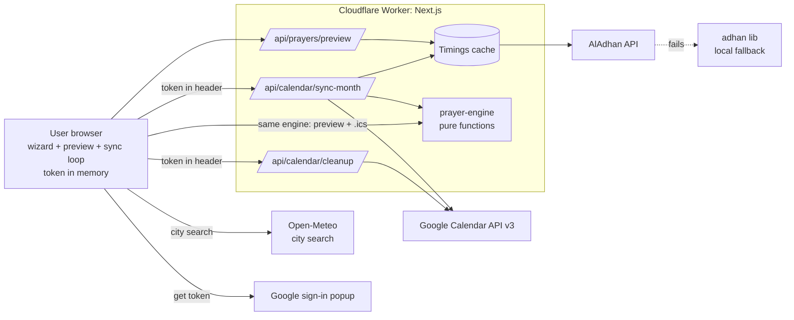

One important rule runs through the whole design: **the engine is the same code in two places**. The browser runs it for the live preview and for building the `.ics` file. The Worker runs it again for the Google sync. The server never trusts times sent by the client; it recomputes everything from prayer data it fetched itself.

## 2. User journey

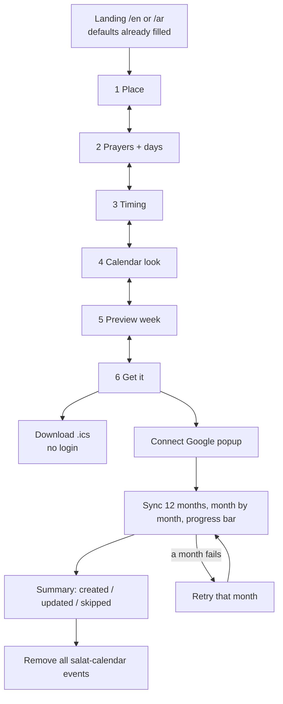

The wizard has six steps. Any step can be opened at any time from the stepper; Back and Next are shortcuts, not gates. Only the place is required. The final buttons stay disabled until it is set, and say what is missing. Every setting has a working default, so a visitor in a hurry can pick a city and go straight to step 6.

## 3. Engine pipeline (per day, per prayer)

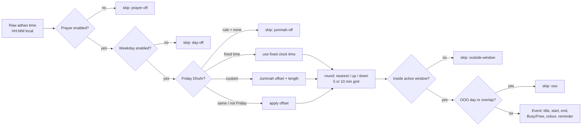

Every skip carries a reason: `prayer-off`, `day-off`, `jummah-off`, `outside-window`, or `ooo`. The preview shows skipped slots greyed out with that reason, and the sync summary counts them.

How times are represented:

- Times stay as **wall-clock minutes plus an IANA timezone** (for example `Europe/London`). No UTC offset maths in our code.
- Google events are sent as local `dateTime` + `timeZone`, so **DST is Google's problem**, not ours.
- An offset that crosses midnight **moves the event to the next date**.

## 4. Sync sequence (one month chunk)

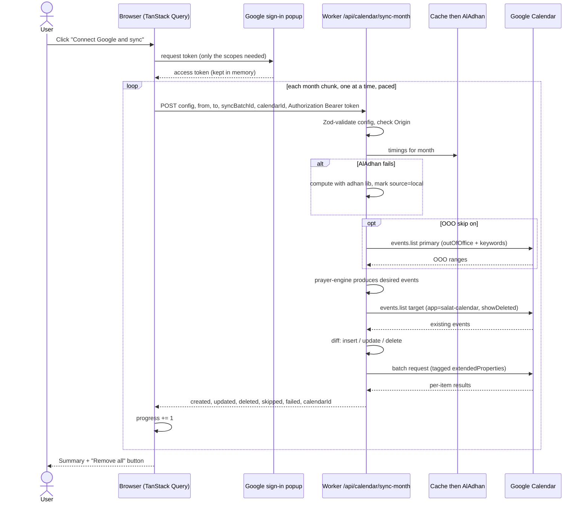

Each month is one HTTP request from the browser to our Worker, and one batch of calls from the Worker to Google. The server holds no job state between requests. The browser holds the queue.

## 5. Reconcile logic (why re-sync is safe)

Each event gets a deterministic ID built from date and prayer, for example `sc20261113p2`. Google rejects a second insert of the same ID, even after delete, so the server compares instead of blindly inserting.

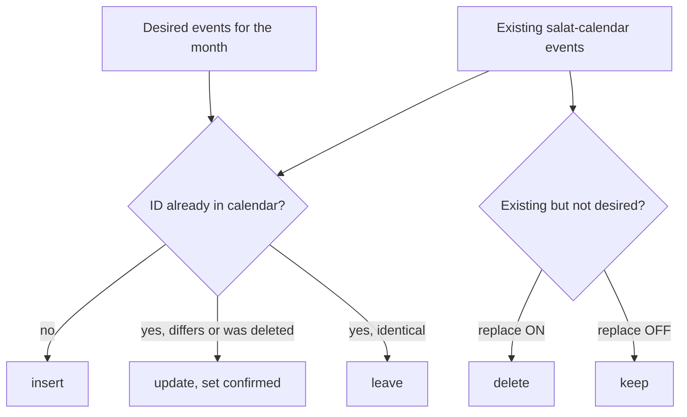

The result is idempotent: a retry or a double click produces the same calendar. Every event carries this tag, and cleanup only ever touches events with it:

```json
"extendedProperties": { "private": { "app": "salat-calendar", "syncBatchId": "<uuid>", "prayer": "dhuhr" } }
```

## 6. Why the client drives monthly requests

A free Cloudflare Worker gets about 10 ms of CPU and 50 outgoing calls per request. One year in one request is up to 1,825 events and would be killed. One month is at most 155 events and about 4 outgoing calls. So **the browser, not the server, drives the sync**, one month at a time:

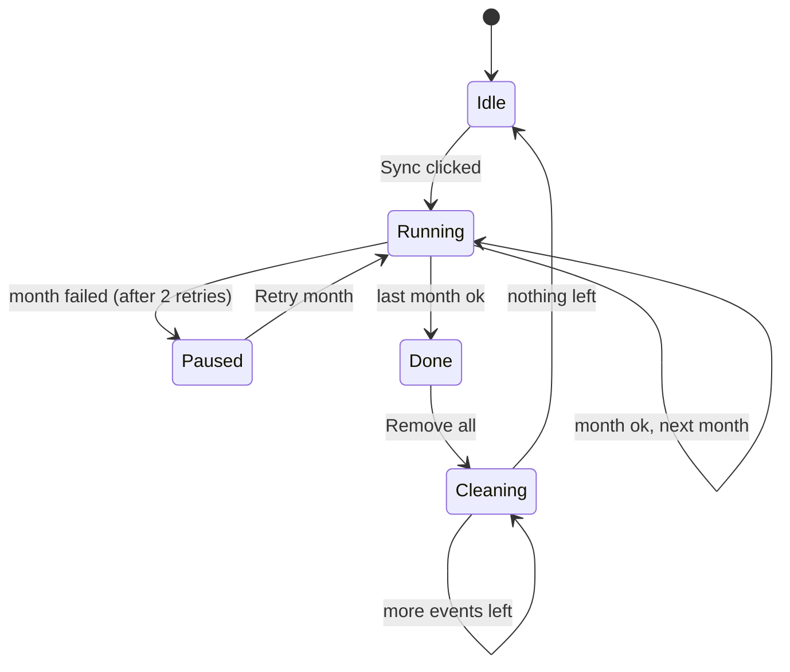

Details of the chunked sync:

- A rolling year from today touches **13 calendar months** (the first and last are partial).
- The chunk size is a **parameter** (`sync/chunks.ts`), so a half-month fallback is a config change, not a rewrite.
- A failed month pauses the sync after 2 retries and offers a Retry button for that month only. Successful months stay written.
- Cleanup works the same way: each call deletes one page of tagged events and reports whether more remain.

## 7. Token and permissions

**Where the token lives**

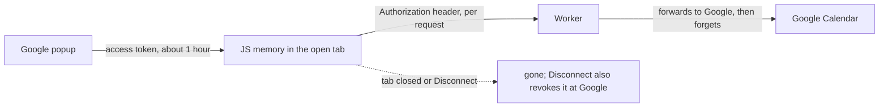

- The access token is **never stored**: not in a cookie, not in `localStorage`, not on our server, not in logs. No refresh token is ever requested.
- There is no page redirect (it is a popup), so the wizard state is not lost and needs no storage either.
- Cost: a script injected into the page could read memory. Mitigation: strict CSP, and the only third-party script is Google's own sign-in script.
- No client secret exists in this flow, so there is no secret to leak.

**Which permissions are asked**

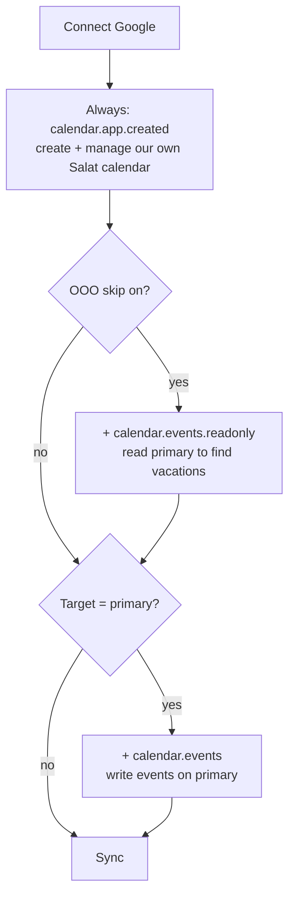

Scopes are incremental. The user is only asked for what their choices need. The privacy page lists each scope and why it is needed.

## 8. Core types

Shared Zod schemas (`src/lib/sync/schema.ts`) and engine types are the contract between client and API routes. Change them first, deliberately.

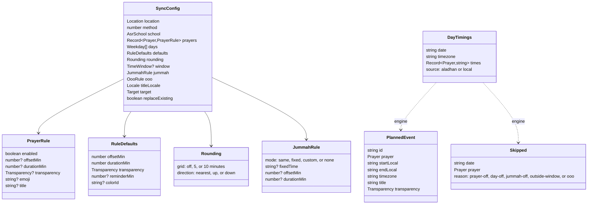

## 9. Timings cache

Prayer times for one place, method and month never change, so every user in the same city can share one stored answer.

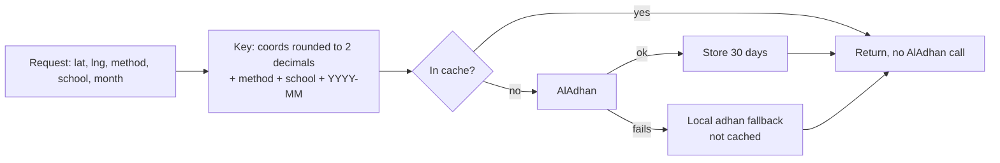

- Storage: Cloudflare's built-in Cache API (`caches.default`). Free, no extra service, no secret. The Step 0 spike found that OpenNext's own adapter relies on the Cache API inside its generated Worker, so our code can use it the same way.
- A `TimingsCache` interface has two implementations: Cache API on Workers, in-memory `Map` for local dev and tests.
- A cache hit makes no AlAdhan call. The local fallback result is **never cached**.
- Limit: the cache is per Cloudflare data centre, not global. Backlog: swap in Cloudflare KV behind the same interface.

## 10. Static `.ics` download

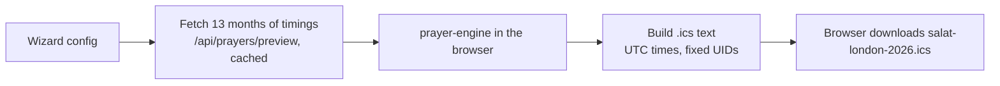

- No login, no Google. Works with Outlook, Apple Calendar, and Google import.
- Same rules as the sync, except vacation skip (a file cannot read the user's calendar). The UI states this trade-off plainly.
- UIDs are fixed per date and prayer, so importing a newer file updates events instead of doubling them (in apps that honour UIDs).
- This is a snapshot for one year. To change rules, download and import again. The UI advises importing into a separate calendar so it can be deleted in one go.

## 11. Why no database

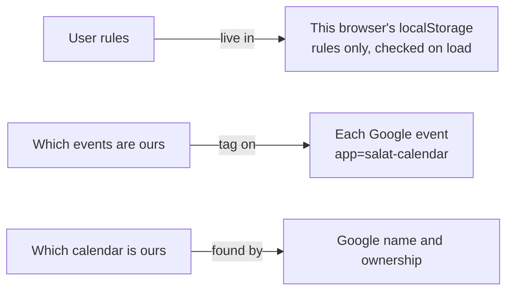

| What needs remembering | Where it already lives                            |
| ---------------------- | ------------------------------------------------- |
| The user's rules       | This browser's localStorage (rules only, checked on load) |
| Which events are ours  | The tag on each Google event                      |
| Which calendar is ours | Google (found by name and ownership)              |
| Prayer times           | Cache, rebuildable from AlAdhan                   |
| Login                  | Nothing kept                                      |

A database would only be needed for accounts or automatic monthly re-sync. Both are backlog items (see [docs/BACKLOG.md](./BACKLOG.md)).

## 12. Security

- Token handling as in section 7: memory only, per-request header, revoked on Disconnect.
- Calendar routes require a bearer token, a same-origin `Origin` header, and a Zod-valid body with hard caps: range at most 31 days, offsets within ±180 minutes, duration 5–180 minutes.
- Cleanup and sync only touch events tagged `app=salat-calendar`. A hand-made personal event is never read or deleted.
- Security headers (CSP, `X-Content-Type-Options`, `Referrer-Policy`, frame denial) in `next.config.ts` — planned to ship with the calendar routes (PR 7).
- `.env*` ignored; Gitleaks and `pnpm audit` run in CI.
- The timings cache also stops the public preview route being used to hammer AlAdhan.

## 13. Capacity and limits

Checked 2026-11-13. Sources: Google Calendar quota docs, AlAdhan community FAQ, Nominatim policy, Cloudflare free plan. The Google daily cap was re-checked 2026-11-14 against Google's own quota page (Step 0 spike 5) and is confirmed.

| Limit                        | Value                                                       | What it means for us                                                                                                                                            |
| ---------------------------- | ----------------------------------------------------------- | --------------------------------------------------------------------------------------------------------------------------------------------------------------- |
| Google, unverified app       | 100 users in total                                          | **The real ceiling until verification.** Everyone else can still use the preview and `.ics`                                                                     |
| Google Calendar, per user    | 600 requests / minute                                       | Worst-case year (5 prayers, 7 days ≈ 1,900 requests) takes about 3–4 minutes; a typical work setup (≈ 800) about 1.5 minutes. The client paces months and backs off on 403/429 |
| Google Calendar, per project | 10,000 requests / minute                                    | About 16 people syncing flat-out at the same moment; more than that queues via backoff. Can be raised on request                                                 |
| Google daily cap             | 1,000,000 requests / day per project (confirmed, Google quota page) | Roughly 500 worst-case full syncs per day; no charges under the threshold                                                                                |
| Cloudflare Workers free      | 100,000 requests / day, 10 ms CPU, 50 outgoing calls per request | A visitor uses about 30 Worker requests (pages and assets are free) → about 3,000 visitors / day. The $5 plan removes this limit                              |
| AlAdhan                      | ~12 requests / second per IP, 70 per 7 seconds              | Only cache misses reach it: one call per new city-month. Fallback covers 429s                                                                                   |
| Open-Meteo geocoding         | Free for non-commercial, fair use (exact number: confirm)   | Called from the user's browser, debounced, so load spreads across users. The `timezone` field was confirmed in the Step 0 spike                                  |
| Google access token          | about 1 hour                                                | Enough for one sync; reconnect if it lapses                                                                                                                     |

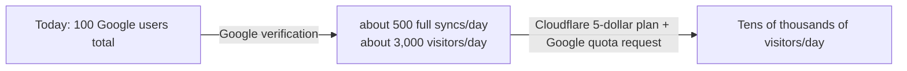

`.ics` downloads and the preview never touch Google quotas, so they scale with Cloudflare alone.
