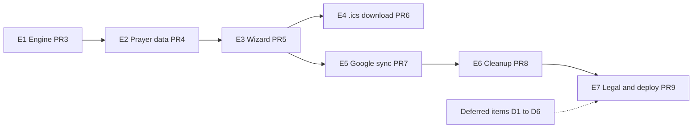

# salat-calendar — Backlog

Source of truth: [docs/PLAN.md](./PLAN.md) (sections 2, 6, 10). This file organises the build slices and the deferred items into epics, stories, acceptance criteria, and tasks. It changes no plan decision.

## How to use

- The v1 epics below map one-to-one to the build slices PR 3 to PR 9 in plan section 10. PR 1 (setup and CI) and PR 2 (documents) sit outside this file.
- The Deferred section holds the six backlog items listed in plan section 2. They are not v1.
- Issues and specs live as local markdown files under `.scratch/<feature>/` (see `docs/agents/issue-tracker.md`). Each issue file carries one `Status:` line from the five triage labels (see `docs/agents/triage-labels.md`).
- One feature branch and one PR per slice. CI must be green, and the reviewer subagent must have no high or medium findings, before a PR opens.

## Map of epics

## E1. prayer-engine (PR 3)

Pure functions only. No I/O, no framework imports. Vitest coverage thresholds: 100 percent for lines, branches, and functions in the engine folder. Tests live next to the code.

### Story: parse and shift times
- Acceptance criteria:
  - The string 04:32 (BST) parses to wall-clock minutes.
  - An offset that crosses midnight moves the event to the next date.
  - Rounding down or a negative offset that puts a block before the adhan still returns a result; the UI may warn.
- Tasks: implement parseTime and applyOffset; test BST and non-DST zones; test the midnight-crossing offset.

### Story: rounding
- Acceptance criteria:
  - Grid is off, 5 minutes, or 10 minutes.
  - Direction is nearest (default), up, or down.
  - Rounding runs after offsets and Jummah resolution, and before the window check.
- Tasks: implement roundToGrid; test all three directions on both grids and on the no-grid path.

### Story: window and overnight windows
- Acceptance criteria:
  - isWithinWindow handles bounds such as 08:00 to 16:00.
  - Overnight windows such as 22:00 to 06:00 work.
  - London December Maghrib passes an 08:00 to 16:00 window while June Maghrib does not.
- Tasks: implement window logic; test DST weeks for London, New York, and Riyadh, which has no DST.

### Story: Jummah rule
- Acceptance criteria:
  - Four modes: same as Dhuhr, fixed time, custom offset and length, or no Friday slot.
  - Fixed mode uses a fixed clock time; custom mode applies a Jummah offset and length.
  - jummah-off is a distinct skip reason.
- Tasks: implement resolveJummah; test all four modes on a Friday.

### Story: OOO exclusion and titles
- Acceptance criteria:
  - All-day OOO removes the whole day; timed OOO removes only overlapping prayers.
  - Skip reasons are distinct: prayer-off, day-off, jummah-off, outside-window, ooo.
  - Titles render in English and Arabic, with emoji and per-prayer overrides.
- Tasks: implement isExcludedByOoo and formatTitle; test planDay and planRange end to end.

## E2. Prayer data, cache, preview API (PR 4)

### Story: AlAdhan client and normaliser
- Acceptance criteria:
  - The monthly calendar endpoint is fetched by coordinates, method, and Asr school.
  - Raw times such as 04:32 (BST) are normalised to wall-clock minutes plus an IANA timezone.
  - HTTP 429 and network failures fall back to the local adhan library, and the fallback result is flagged as source local.
- Tasks: implement the AlAdhan client and the normaliser; record fixtures for London and Riyadh.

### Story: TimingsCache
- Acceptance criteria:
  - Key is coordinates rounded to 2 decimals plus method plus school plus YYYY-MM.
  - Entries live 30 days.
  - A cache hit makes no AlAdhan call; the fallback is never cached.
  - Workers use the Cloudflare Cache API; local dev and tests use an in-memory Map, behind one interface.
- Tasks: define the interface; implement both backends; test hit, miss, and fallback-not-cached.

### Story: preview API route
- Acceptance criteria:
  - The route returns timings for a requested range for the preview and the .ics file.
  - The second call for the same city-month is served from the cache.
- Tasks: implement the route handler; test with recorded fixtures; check with a curl of London and Riyadh.

## E3. Wizard and live preview (PR 5)

### Story: wizard shell and i18n
- Acceptance criteria:
  - Routes /en and /ar work; Arabic is right to left with Latin numerals and logical CSS properties.
  - The stepper is clickable; any step opens in any order; back and next are shortcuts, not gates.
  - Every step has working defaults; a visitor can pick a city and go straight to step 6.
  - A step with a problem shows a small mark in the stepper, and disabled buttons say what is missing.
- Tasks: set up next-intl routing; build the stepper, the Zustand config store, and the validity marks.

### Story: place step
- Acceptance criteria:
  - City search uses Open-Meteo geocoding with debounce and returns a timezone.
  - GPS detect works and shows the plan-adapted error messages on failure.
  - Calculation method is suggested from the country; the Asr school is selectable.
- Tasks: build StepPlace, the geocoding hook, and the method table.

### Story: rules steps
- Acceptance criteria:
  - Prayer toggles, weekday presets, global default offset and duration, Busy or Free, and per-prayer customise.
  - Rounding, time window, and all four Jummah modes match the engine.
  - Calendar look step covers title locale, colour, reminder, target calendar, OOO keywords, and the replace toggle.
- Tasks: build StepPrayers, StepTiming, and StepCalendar against the shared Zod schema.

### Story: preview step
- Acceptance criteria:
  - A mini live preview stays visible in every wizard step; on mobile it is a Preview button.
  - The full 7-day grid shows Busy, Free, and Skipped blocks, with skip reasons on hover.
  - London with an 08:00 to 16:00 window hides Maghrib in June and shows it in December.
  - A week counter moves between weeks; the year estimate is shown.
- Tasks: build WeekGrid and MiniPreview; wire the preview query through TanStack Query.

## E4. .ics download (PR 6)

### Story: ics builder
- Acceptance criteria:
  - The builder is pure and tested: line folding, escaping, UTC conversion across DST, and fixed UIDs per date and prayer.
  - Same rules as the sync, except vacation skip, which is impossible for a file.
  - Importing a newer file updates events instead of doubling them in apps that honour UIDs.
- Tasks: implement ics.ts and the download card; test a DST-change week; check by importing into Google Calendar and one other app.

### Story: download card
- Acceptance criteria:
  - The card explains the trade-off plainly: a snapshot for one year; to change rules, download and import again.
  - It advises importing into a separate calendar so it can be deleted in one go.
  - The download button is disabled with a message until a place is set.
- Tasks: build DownloadCard and the useIcsDownload hook.

## E5. Google connect and sync (PR 7)

### Story: token popup
- Acceptance criteria:
  - Google Identity Services popup requests only the scopes the current choices need.
  - The token lives in browser memory only; it is sent in the Authorization header per request and forgotten.
  - Scopes are incremental: always calendar.app.created; plus calendar.events.readonly when OOO skip is on; plus calendar.events when the target is the primary calendar.
  - Disconnect revokes the token at Google.
- Tasks: implement the auth flow and scope logic; test that no token reaches storage or logs.

### Story: sync-month API route
- Acceptance criteria:
  - The route requires a bearer token, a same-origin Origin header, and a Zod-valid body with hard caps: range at most 31 days, offsets within 180 minutes, duration 5 to 180 minutes.
  - The server recomputes events with the engine; it never trusts client times.
  - Only events tagged app=salat-calendar are read or written.
  - AlAdhan failure falls back to the local library and flags source local.
- Tasks: build the route, validation, and the OOO lookup against the primary calendar.

### Story: reconcile logic
- Acceptance criteria:
  - Desired events compare against existing tagged events by deterministic ID, for example sc20261113p2.
  - Insert, update, or leave, per the plan section 4.5 diagram; a retry or a double click produces the same calendar.
  - With replace on, orphans are deleted; with replace off, they are kept.
  - Every event carries extendedProperties private app=salat-calendar, a syncBatchId, and the prayer name.
- Tasks: implement the reconcile module and batch encoding with partial-failure handling; test all paths.

### Story: paced year sync in the browser
- Acceptance criteria:
  - The browser drives one month at a time, paced, over a rolling 12 months, which touches 13 calendar months.
  - A failed month pauses the sync after 2 retries and offers a Retry button.
  - The progress bar, per-month results, and the final summary show created, updated, deleted, and skipped counts.
  - A sync writes at most 155 events in a month chunk; the chunk size is a parameter.
- Tasks: implement useYearSync and the progress UI; test chunk maths and the state machine.

## E6. Cleanup (PR 8)

### Story: remove all
- Acceptance criteria:
  - The cleanup route deletes only tagged events, one page per call, and reports whether more remain.
  - The confirm dialog states the count and that personal events are untouched.
  - Disconnect revokes the token.
- Tasks: build the route, the paged delete loop, and the confirm dialog; check that a hand-made event survives.

## E7. Legal pages and deploy (PR 9)

### Story: privacy and terms
- Acceptance criteria:
  - The privacy page lists each Google scope and why it is needed, states that nothing is stored, and follows the Google Limited Use rules.
  - The terms page ships on the app domain, which the plan section 8.4 requires for verification.
- Tasks: write both pages in en and ar.

### Story: deploy to Cloudflare Workers
- Acceptance criteria:
  - wrangler.jsonc and open-next.config.ts build and wrangler dev serves the app.
  - The live URL is added to the Google client origins.
  - docs/VERIFICATION.md covers the plan section 8.4 steps, scope justifications, and the demo video script.
- Tasks: wire the deploy; write the verification guide.

## Deferred (not v1)

These six items come straight from the plan section 2 backlog row. None blocks v1, and none is promised.

### D1. Dark mode
- Story: as a visitor, I can read the app comfortably at night.
- Acceptance criteria: a theme toggle respects the OS setting; the wizard, preview, and download card are readable in both themes.
- Tasks: add the theme token set and the toggle; check contrast on the preview grid.

### D2. Saved settings and share link
- Story: as a returning user, my rules can be saved or shared without an account.
- Acceptance criteria: the full SyncConfig can be encoded into a link that recreates the same wizard state; a share link leaks nothing private because it holds rules only, never tokens or calendar data.
- Tasks: define the URL encoding on top of the shared Zod schema.
- Done so far (after PR 6): settings are saved in this browser's `localStorage` (`src/features/wizard/savedSettings.ts`), validated on load, with a "Reset to defaults" button. The share link is still open.

### D3. Meeting gap-finding
- Story: as an office professional, my prayer events land in real gaps between meetings, not on top of them.
- Acceptance criteria: the engine proposes placements inside the active window that do not overlap existing events; the preview shows which gaps were chosen and why.
- Tasks: extend the engine with a gap-search function; define how the server reads busy times under the narrow scope.
- Note: Sutrah already does this live on Google Calendar and Outlook, and Fajr Calendar ships a prayer-aware meeting finder. Both verified on their home pages.

### D4. Auto monthly re-sync
- Story: as a user, my calendar stays full without me re-running the wizard.
- Acceptance criteria: a scheduled job re-syncs the rolling window; it needs the owners consent, server-side state, and a design decision the plan defers because it is one of the two things a database would be needed for.
- Tasks: design the trigger and the consent model with the owner before any code.

### D5. Global KV cache
- Story: as a visitor, my first preview of a popular city is fast wherever I am.
- Acceptance criteria: Cloudflare KV backs the TimingsCache interface; the per-data-centre Cache API limitation from the plan section 4.9 goes away; no interface change for callers.
- Tasks: add the KV backend, keep the local Map for tests, compare cost and hit rates.

### D6. Hosted .ics subscribe URL
- Story: as a Bilal persona user, I can subscribe to a live .ics URL instead of importing a file every year.
- Acceptance criteria: a URL serves a rules-generated .ics on demand; the plan section 4.10 trade-offs are reconsidered, including server rules storage.
- Tasks: design the route and the storage of rules with the owner; note that hosted rules storage is the third thing a database would be needed for.

## Status of this file

- v1 epics (as of 2026-11-25): **E1 to E4 done** (PR 3 to PR 6, plus follow-ups #21 to #26). **E5 to E7 not started**; E5 (Google sync) is next.
- Deferred D1 to D6: not scheduled, except D2's first half (settings saved in the browser), done in #23. D3, D4, and D6 each need an owner decision before any code, because the plan rules out the storage they seem to need.
- Per the issue-tracker convention, each story becomes an issue file under .scratch/<feature>/ with a Status line when work starts.
