# salat-calendar: project plan

## 1. Context

Prayer times move a few minutes every day with the sun, so a normal "repeat daily at 12:30" calendar event is wrong within a week. `salat-calendar` is a web app that reads a full year of prayer times for a location, applies the user's rules (offset, duration, rounding, time window, Friday rule, vacation skip), and either writes real events to Google Calendar or hands the user an `.ics` file. It can remove everything it wrote to Google in one click.

It is an open-source project under the GitHub organization `hijri-js` (repo `hijri-js/salat-calendar`), shown on `khaled-portfolio.pages.dev`. It must show the whole product path: problem, competitor analysis, scoping, architecture, tested code, delivery. It is also Khaled's first real Next.js project, so the build doubles as a learning track.

The code lives in the git repo `hijri-js/salat-calendar`. `instructions.md` and `gemini-chat.md` were the starting notes (reference only, not facts).

---

## 2. Decisions

| Topic            | Decision                                                                                                                                               |
| ---------------- | ------------------------------------------------------------------------------------------------------------------------------------------------------ |
| Build scope      | Fully working end to end: real Google sign-in, sync, cleanup                                                                                           |
| OAuth path       | Works for test users now; built ready for Google verification (narrow scopes, privacy + terms pages)                                                   |
| Token            | Never stored. Lives in browser memory for the open tab only; passed per request through our stateless API (see 4.7)                                    |
| Lessons          | `learning/` folder, git-ignored                                                                                                                        |
| Database         | None (see 4.11)                                                                                                                                        |
| Prayer times     | AlAdhan `/v1/calendar` by coordinates; local `adhan` library as fallback                                                                               |
| Timings cache    | Cloudflare Cache API behind a `TimingsCache` interface, 30-day entries; no Redis                                                                       |
| City search      | Open-Meteo geocoding (type-ahead allowed, returns timezone). Not Nominatim: its policy bans autocomplete and allows 1 request/second for the whole app |
| Sync range       | Rolling 12 months from today                                                                                                                           |
| Re-sync          | Replaces earlier salat-calendar events by default; user can turn "replace" off                                                                         |
| Rule detail      | Global default offset/duration/Busy-Free, optional per-prayer override                                                                                 |
| Rounding         | Off, or snap to a 5 / 10 minute grid; user picks direction: nearest (default), up, or down                                                             |
| Friday           | Four choices: same as Dhuhr (**default**), fixed time, custom offset/length, or **no Friday slot**                                                                   |
| Default timing   | Events start **exactly at the adhan** (offset 0) and Friday Dhuhr follows its adhan; nothing moves unless the user shifts it. The Place step shows only the real adhan times; a second line appears only for a prayer the user moved or that is skipped |
| OOO skip         | All-day OOO removes the whole day; timed OOO removes only overlapping prayers; keyword list editable                                                   |
| Target calendar  | Dedicated "Salat" calendar by default; primary optional, extra permission asked only then                                                              |
| Second output    | Download a static `.ics` file for the same rules, no login (see 4.10)                                                                                  |
| Layout           | Wizard, free navigation, working defaults (see 6)                                                                                                      |
| Extras in v1     | Custom emoji + title per prayer; event reminder + colour                                                                                               |
| Backlog (not v1) | Dark mode; share link (settings are already saved in the browser); meeting gap-finding; auto monthly re-sync; global KV cache; hosted `.ics` subscribe URL                        |
| Deploy           | Cloudflare Workers via `@opennextjs/cloudflare`                                                                                                        |
| Repo and flow    | `hijri-js/salat-calendar`; feature folders; one feature branch and one PR per slice; CI runs on every PR                                               |
| License          | Apache-2.0                                                                                                                                             |

### What we take from `salat-time`

| Take (copy and adapt)                                                | Leave                                                               |
| -------------------------------------------------------------------- | ------------------------------------------------------------------- |
| GPS detect flow and its error messages (`useLocation.ts`)            | Nominatim type-ahead search (policy problem above)                  |
| `suggestMethod` country → method table (`src/utils/calculations.ts`) | Single-day `timings` call (we need the monthly `calendar` endpoint) |
| Method list (15) + Asr school types                                  | PWA, service worker, gradients, countdown                           |
| `ApiError` codes (`NETWORK`, `RATE_LIMIT`, `SERVER`...)              | Custom `useTranslation` hook (we use `next-intl`)                   |
| EN/AR prayer and method names (`public/locales/*.json`)              |                                                                     |

Copied in, not added as a dependency (it is a Vite SPA, not a library).

### Name

The project is **`salat-calendar`** (was `salaat-sync` in `instructions.md`). Reasons: a product called SalahSync already does Google prayer sync; `salat` matches the sibling project `salat-time`; and "calendar" covers both the Google sync and the `.ics` file.

Checked on 2026-11-13: the npm name `salat-calendar` is free, `hijri-js/salat-calendar` is free, and no GitHub repo has that exact name.

How the name gets held (no one can truly reserve a descriptive name without a trademark, which is not worth it here):

| Where      | How                                                                                                                        | When                                              |
| ---------- | -------------------------------------------------------------------------------------------------------------------------- | ------------------------------------------------- |
| GitHub     | Create public repo `hijri-js/salat-calendar`                                                                               | PR 1 (first action)                               |
| npm        | Publish a tiny placeholder `salat-calendar@0.0.0` that points to the repo. Needs your `npm login`; I ask before publishing | Your call, after PR 1                             |
| Domain     | Buy one, e.g. `salatcalendar.app` or `.com`. Also required for Google verification (8.4)                                   | Your call; do it early if you want public sign-in |
| Google     | Cloud project and OAuth app named `salat-calendar`                                                                         | Step 8.1                                          |
| Cloudflare | Worker named `salat-calendar`                                                                                              | PR 9                                              |

In code: the event tag is `app=salat-calendar`, event IDs start with `sc`, and the dedicated Google calendar is titled "Salat". The local folder can be renamed from `salaat-sync` to `salat-calendar` before PR 1; I will ask you to do it, since it changes this session's working directory.

### Assumptions (tell me if any is wrong)

1. A small live preview stays visible in every wizard step (side panel on desktop, "Preview" button on mobile). The full 7-day grid is its own step.
2. If rounding down or a negative offset puts a block before the adhan, the UI shows a small warning but allows it.
3. Wireframes are the text diagrams in section 6. Visual design is done during the build with the design skills in section 8.
4. This plan is copied to `docs/PLAN.md` in the first PR.

---

## 3. Tech stack

| Layer          | Choice                                                                                 |
| -------------- | -------------------------------------------------------------------------------------- |
| Framework      | Next.js (latest, App Router), TypeScript strict, pnpm only                             |
| UI             | Tailwind CSS v4, native HTML elements (`dialog`, `details`, `popover`), Lucide icons, logical properties (`ms-`, `pe-`...); see [ADR 0001](adr/0001-native-ui-over-shadcn.md) |
| i18n           | `next-intl`, routes `/en` and `/ar`, `dir="rtl"` for Arabic, numerals stay Latin       |
| Client state   | Zustand (wizard config, saved to this browser's localStorage)                          |
| Server state   | TanStack Query (preview query; one mutation per month chunk)                           |
| Validation     | Zod schemas shared by client and API routes                                            |
| Google sign-in | Google Identity Services token popup (native OAuth, no Auth.js, no client secret)      |
| Prayer data    | AlAdhan REST → fallback `adhan`                                                        |
| Calendar       | Google Calendar REST v3 through plain `fetch`                                          |
| Tests          | Vitest + v8 coverage (100% threshold on `prayer-engine`)                               |
| CI             | GitHub Actions: Gitleaks, `pnpm audit`, `tsc`, ESLint, Vitest; Dependabot weekly       |
| Deploy         | Cloudflare Workers, `@opennextjs/cloudflare`, `wrangler.jsonc`                         |

---

## 4. Architecture

### 4.1 System context

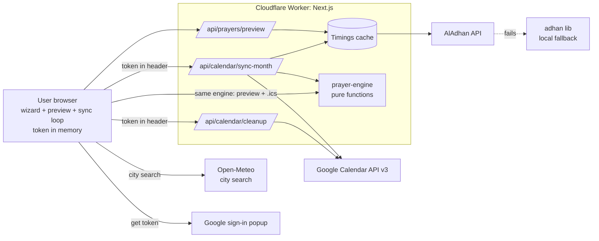

The engine is the same code in two places: the browser runs it for the preview and the `.ics` file, and the Worker runs it for the Google sync (the server never trusts times sent by the client).

### 4.2 User journey

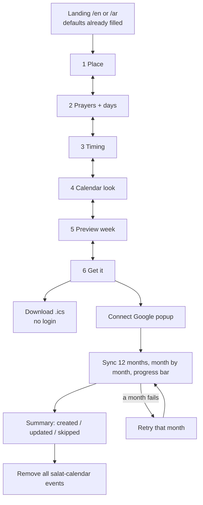

Any step can be opened at any time from the stepper. Only the place is required; the final buttons stay disabled until it is set.

### 4.3 Engine pipeline (per day, per prayer)

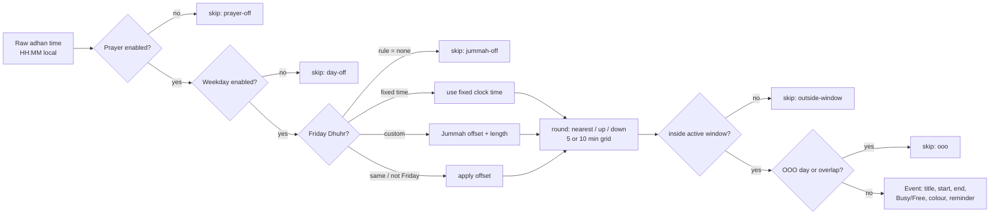

Every skip carries a reason. The preview shows skipped slots greyed out with that reason, and the sync summary counts them.

Times stay as wall-clock minutes plus an IANA timezone (`Europe/London`). Google events are sent as local `dateTime` + `timeZone`, so Google applies DST. An offset that crosses midnight moves the event to the next date.

### 4.4 Sync sequence (one month chunk)

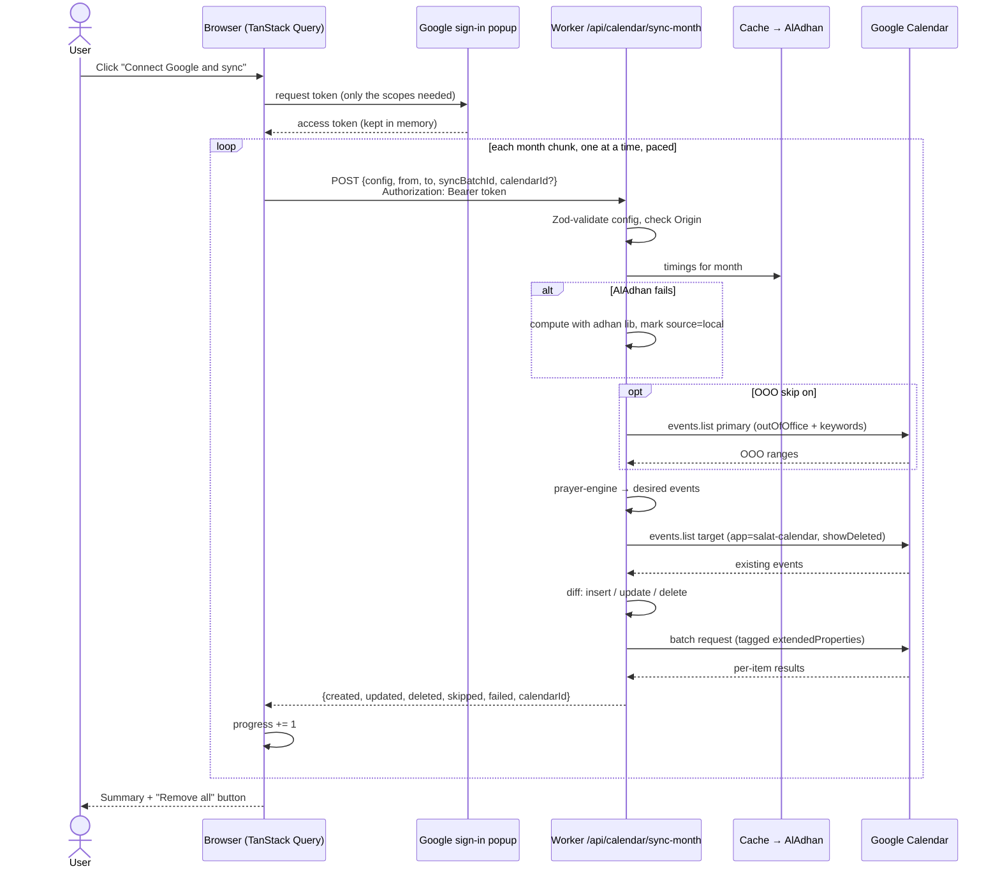

### 4.5 Reconcile logic (why re-sync is safe)

Each event gets a fixed ID built from date and prayer, for example `sc20261113p2`. Google rejects a second insert of the same ID, even after delete, so the server compares instead of blindly inserting.

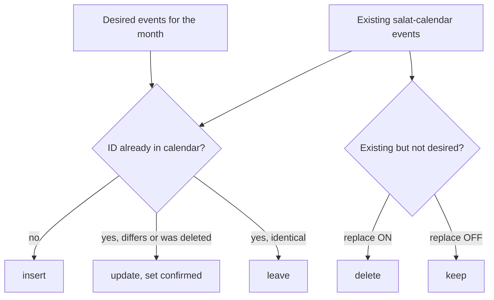

A retry or a double click produces the same calendar. Every event carries:

```json
"extendedProperties": { "private": { "app": "salat-calendar", "syncBatchId": "<uuid>", "prayer": "dhuhr" } }
```

### 4.6 Why the client drives monthly requests

A free Cloudflare Worker gets about 10 ms of CPU and 50 outgoing calls per request. One year in one request is up to 1,825 events and would be killed. One month is at most 155 events and about 4 outgoing calls.

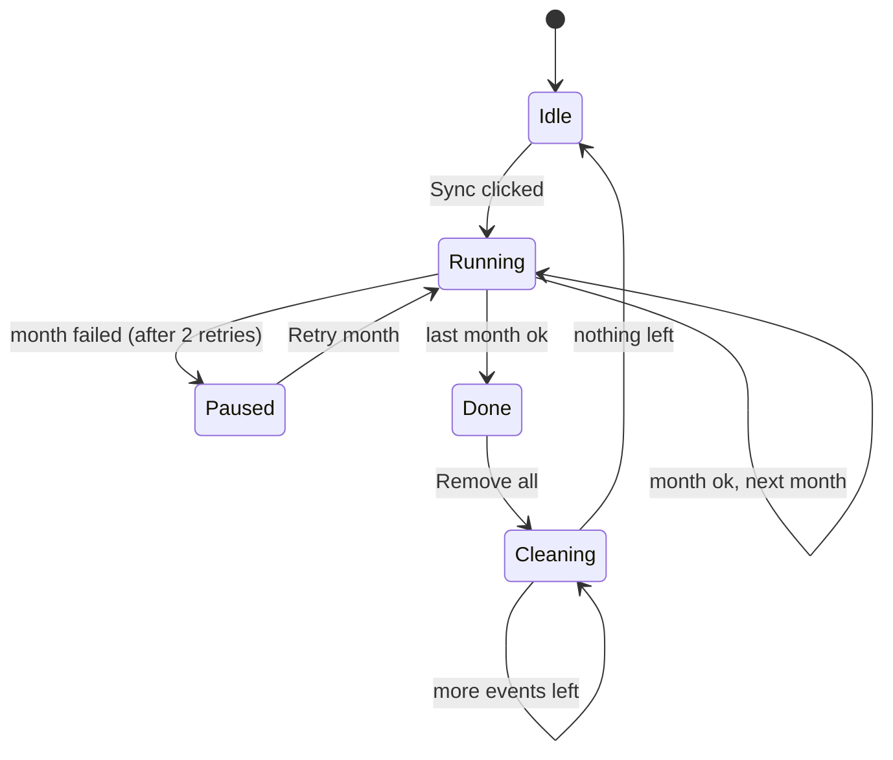

A rolling year touches 13 calendar months (first and last are partial). The server holds no job state; the browser holds the queue. Cleanup works the same way: each call deletes one page and reports whether more remain.

### 4.7 Token and permissions

**Where the token lives**

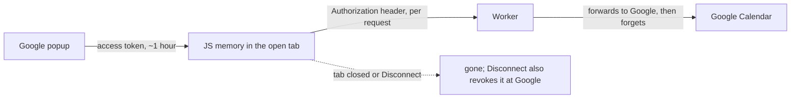

- Not in a cookie, not in `localStorage`, not on our server, not in logs. No refresh token is ever requested.
- There is no page redirect (it is a popup), so the wizard state is not lost and needs no storage either.
- Cost: a script injected into the page could read memory. Mitigation: strict CSP, the only third-party script is Google's sign-in script.
- No client secret exists in this flow, so there is no secret to leak.

**Which permissions are asked**

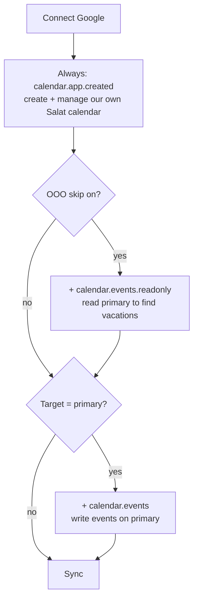

The user is only asked for what their choices need. The privacy page lists each scope and why.

### 4.8 Core types

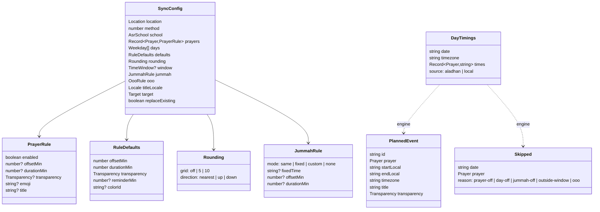

### 4.9 Timings cache

Prayer times for one place, method and month never change, so every user in the same city can share one stored answer.

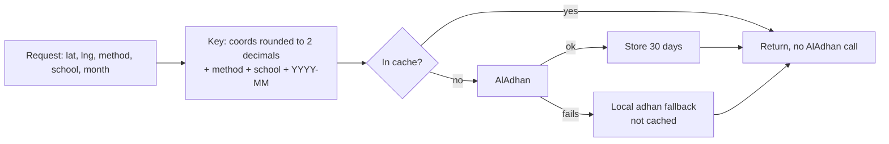

- Storage: Cloudflare's built-in Cache API (`caches.default`). Free, no extra service or secret.
- `TimingsCache` interface with two implementations: Cache API on Workers, in-memory `Map` for local dev and tests.
- Limit: the cache is per Cloudflare data centre, not global. Backlog: swap in Cloudflare KV behind the same interface.

### 4.10 Static `.ics` download

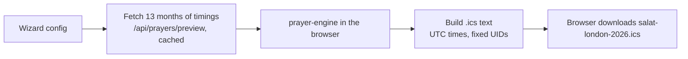

- No login, no Google. Works with Outlook, Apple Calendar, and Google import.
- Same rules as the sync, except vacation skip (it cannot read the user's calendar).
- UIDs are fixed per date and prayer, so importing a newer file updates events instead of doubling them (in apps that honour UIDs).
- The UI states the trade-off plainly: a snapshot for one year; to change rules, download and import again; advise importing into a separate calendar so it can be deleted in one go.
- This also strengthens the PRD: we offer the static option ourselves and explain when the live sync is better.

### 4.11 Why no database

| What needs remembering | Where it already lives                            |
| ---------------------- | ------------------------------------------------- |
| The user's rules       | This browser's localStorage (rules only, checked on load) |
| Which events are ours  | The tag on each Google event                      |
| Which calendar is ours | Google (found by name/ownership; Step 0 confirms) |
| Prayer times           | Cache, rebuildable from AlAdhan                   |
| Login                  | Nothing kept                                      |

A database would only be needed for accounts or automatic monthly re-sync. Both are backlog items.

### 4.12 Security

- Token handling as in 4.7.
- Calendar routes require a bearer token, a same-origin `Origin` header, and a Zod-valid body with hard caps (range ≤ 31 days, offsets ±180 min, duration 5–180 min).
- Cleanup and sync only touch events tagged `app=salat-calendar`.
- Security headers (CSP, `X-Content-Type-Options`, `Referrer-Policy`, frame denial) in `next.config.ts`.
- `.env*` ignored; Gitleaks and `pnpm audit` in CI.
- The timings cache also stops the public preview route being used to hammer AlAdhan.

---

## 5. Capacity and limits

Checked on 2026-11-13. Sources: Google Calendar quota docs, AlAdhan community FAQ, Nominatim policy, Cloudflare free plan. Items marked (confirm) are re-checked in Step 0.

| Limit                        | Value                                                            | What it means for us                                                                                                                                                           |
| ---------------------------- | ---------------------------------------------------------------- | ------------------------------------------------------------------------------------------------------------------------------------------------------------------------------ |
| Google, unverified app       | 100 users in total                                               | **The real ceiling until verification.** Everyone else can still use the preview and `.ics`                                                                                    |
| Google Calendar, per user    | 600 requests / minute                                            | Worst-case year (5 prayers, 7 days ≈ 1,900 requests) takes about 3–4 minutes; a typical work setup (≈ 800) about 1.5 minutes. The client paces months and backs off on 403/429 |
| Google Calendar, per project | 10,000 requests / minute                                         | About 16 people syncing flat-out at the same moment; more than that queues via backoff. Can be raised on request                                                               |
| Google daily cap             | 1,000,000 / day reported by a third party (confirm)              | Roughly 500 worst-case full syncs per day                                                                                                                                      |
| Cloudflare Workers free      | 100,000 requests / day, 10 ms CPU, 50 outgoing calls per request | A visitor uses about 30 Worker requests (pages and assets are free) → about 3,000 visitors / day. The $5 plan removes this limit                                               |
| AlAdhan                      | ~12 requests / second per IP, 70 per 7 seconds                   | Only cache misses reach it: one call per new city-month. Fallback covers 429s                                                                                                  |
| Open-Meteo geocoding         | Free for non-commercial, fair use (confirm exact number)         | Called from the user's browser, debounced, so load spreads across users                                                                                                        |
| Google access token          | ~1 hour                                                          | Enough for one sync; reconnect if it lapses                                                                                                                                    |

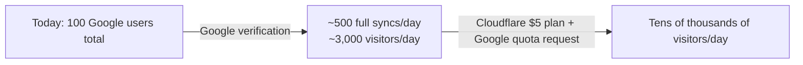

`.ics` downloads and the preview never touch Google quotas, so they scale with Cloudflare alone.

---

## 6. Wizard and wireframes

**How the wizard behaves**

- Every setting has a default, so a visitor in a hurry can pick a city and go straight to step 6.
- The stepper is clickable; any step can be opened in any order. Back/Next are shortcuts, not gates.
- A step with a problem shows a small mark in the stepper (for example ● Place: "pick a city").
- "Connect Google and sync" and "Download .ics" are disabled until required settings are valid. Today that is only the place. The button says what is missing.

### Step 1: Place (desktop, EN)

```
┌──────────────────────────────────────────────────────────────────────┐
│ 🕌 salat-calendar                                      [EN | ع]  GitHub │
├──────────────────────────────────────────────────────────────────────┤
│  ●━━━━━○━━━━━○━━━━━○━━━━━○━━━━━○      (all clickable)                │
│  Place  Prayers Timing Calendar Preview Get it                       │
├───────────────────────────────────────────┬──────────────────────────┤
│  Where are you?                           │  Today in London         │
│                                           │  ┌────────────────────┐  │
│  [🔍 London, United Kingdom          ▾]   │  │ 🌅 Fajr     06:20  │  │
│  [📍 Use my location]                     │  │ ☀️ Dhuhr    12:00  │  │
│                                           │  │ 🌤️ Asr      14:15  │  │
│  Calculation method                       │  │ 🌇 Maghrib  ─ off  │  │
│  [Muslim World League                ▾]   │  │ 🌙 Isha     ─ off  │  │
│  suggested for United Kingdom             │  └────────────────────┘  │
│                                           │  3 events today          │
│  Asr school   (•) Shafi'i  ( ) Hanafi     │  Timezone Europe/London  │
│                                           │                          │
│                              [ Next ▶ ]   │                          │
└───────────────────────────────────────────┴──────────────────────────┘
```

### Step 2: Prayers and days

```
│  Which prayers?                                                      │
│  ┌─────────────────────────────────────────────────────────────┐     │
│  │ [✓] 🌅 Fajr       Busy ▾                      [Customise ▸] │     │
│  │ [✓] ☀️ Dhuhr      Busy ▾                      [Customise ▾] │     │
│  │      Offset [ +0] min  Length [20] min                      │     │
│  │      Emoji [☀️]  Title [Dhuhr            ]                  │     │
│  │ [✓] 🌤️ Asr        Busy ▾                      [Customise ▸] │     │
│  │ [ ] 🌇 Maghrib                                              │     │
│  │ [ ] 🌙 Isha                                                 │     │
│  └─────────────────────────────────────────────────────────────┘     │
│  Which days?                                                         │
│  [Sun✓][Mon✓][Tue✓][Wed✓][Thu✓][Fri ][Sat ]   Presets: All · Sun–Thu · Mon–Fri │
│                                         [ ◀ Back ]  [ Next ▶ ]       │
```

### Step 3: Timing

```
│  Default for all prayers                                             │
│  Start [ +0] min after adhan      Length [20] min                    │
│                                                                      │
│  [✓] Snap start to the clock   grid (•) 5 min ( ) 10 min             │
│      direction (•) Nearest  ( ) Up  ( ) Down      11:41 → 11:40      │
│                                                                      │
│  [✓] Only book inside these hours   [08:00] to [16:00]               │
│      London Maghrib: 15:53 in Dec ✓   21:21 in Jun ✗                 │
│                                                                      │
│  Friday (Jummah)                                                     │
│  (•) Same as Dhuhr                                                   │
│  ( ) Fixed time   [12:30]   Length [60] min                          │
│  ( ) Custom       Start [+0] min   Length [45] min                   │
│  ( ) No Friday slot           e.g. Friday is a day off               │
│                                         [ ◀ Back ]  [ Next ▶ ]       │
```

### Step 4: Calendar

```
│  Event titles in   (•) English  ( ) العربية      e.g. ☀️ Dhuhr        │
│  Colour  [● Sage ▾]        Reminder [5 min before ▾]                 │
│                                                                      │
│  For Google sync                                                     │
│  Write to  (•) A separate "Salat" calendar    recommended            │
│            ( ) My primary calendar            one more permission    │
│  [✓] Skip days I am away                                             │
│      Out-of-office events, and events containing:                    │
│      [Vacation ×][OOO ×][Out of Office ×][Flight ×][إجازة ×][+ add]  │
│  [✓] Replace events from earlier syncs                               │
│                                         [ ◀ Back ]  [ Next ▶ ]       │
```

### Step 5: Preview

```
│  Your next 7 days                       [◀ week]  13–19 Nov  [week ▶]│
│       Fri 13   Sat 14   Sun 15   Mon 16   Tue 17   Wed 18   Thu 19   │
│  06 ┌────────────────────────────────────────────────────────────┐   │
│  07 │  ░off░   ░off░   ▓Fajr▓   ▓Fajr▓   ▓Fajr▓   ▓Fajr▓   ▓Fajr▓ │   │
│  08 │- - - - - - - - - - window starts 08:00 - - - - - - - - - - │   │
│  12 │  ░off░   ░off░   █Dhuhr   █Dhuhr   █Dhuhr   █Dhuhr   █Dhuhr │   │
│  14 │  ░off░   ░off░   █Asr █   █Asr █   █Asr █   █Asr █   █Asr █ │   │
│  16 │- - - - - - - - - - window ends 16:00 - - - - - - - - - - - │   │
│  17 │                  ░Maghrib skipped: outside window░          │   │
│     └────────────────────────────────────────────────────────────┘   │
│  █ Busy   ▓ Free   ░ Skipped (hover for reason)                      │
│  15 events this week · about 780 for the year                        │
│                                         [ ◀ Back ]  [ Next ▶ ]       │
```

### Step 6: Get it

```
│  ┌───────────────────────────────┐  ┌───────────────────────────────┐│
│  │ Sync to Google Calendar       │  │ Download a file (.ics)        ││
│  │ Live events, vacation skip,   │  │ Works in Outlook and Apple.   ││
│  │ one-click removal.            │  │ A one-year snapshot; no       ││
│  │ [ Connect Google and sync ▶ ] │  │ vacation skip. [ Download ⬇ ] ││
│  └───────────────────────────────┘  └───────────────────────────────┘│
│  (both disabled, with "Pick a city first", until a place is set)     │
│                                                                      │
│  Syncing to "Salat"                                                  │
│  ███████████████░░░░░░░░░░░░░  7 of 13 months                        │
│  ✓ Nov 2026  61 created                                              │
│  ✓ Dec 2026  66 created · 10 skipped (away 22–26 Dec)                │
│  ⟳ May 2027  working…                                                │
│  ✗ Apr 2027  Google was busy            [Retry]                      │
│  ──────────────────────────────────────────────────────────────────  │
│  Done: 780 created · 0 updated · 41 skipped                          │
│  [Open Google Calendar]      [🗑 Remove all salat-calendar events]       │
│  Connected as k•••@gmail.com · [Disconnect]                          │
```

"Remove all" opens a confirm dialog that states the count and that personal events are untouched.

### Mobile (step 3) and Arabic (step 2, mirrored)

```
┌──────────────────────┐   ┌──────────────────────────────────────────┐
│ 🕌 salat-calendar  EN|ع │   │ GitHub  [EN | ع]              salat-calendar 🕌 │
│ ①②❸④⑤⑥  Timing      │   │        ○━━━━━○━━━━━○━━━━━○━━━━━●━━━━━○    │
│ Start [ +0] min      │   │                             أي الصلوات؟  │
│ Length [20] min      │   │ [◂ تخصيص]            ▾ مشغول  الفجر 🌅 [✓] │
│ [✓] Snap 5 · Nearest │   │ [◂ تخصيص]            ▾ مشغول  الظهر ☀️ [✓] │
│ [✓] 08:00 to 16:00   │   │ [◂ تخصيص]            ▾ مشغول  العصر 🌤️ [✓] │
│ Jummah: as Dhuhr     │   │                               المغرب 🌇 [ ] │
│                      │   │                               العشاء 🌙 [ ] │
│ [👁 Preview · 3/day] │   │                                          │
│ [◀ Back]   [Next ▶]  │   │       [ ◀ التالي ]  [ السابق ▶ ]          │
└──────────────────────┘   └──────────────────────────────────────────┘
```

---

## 7. File layout (by feature)

Code for one feature sits together: its components, hooks, logic, and tests. Shared, framework-free logic sits in `lib/`.

```
salat-calendar/
├─ .github/{dependabot.yml, workflows/ci-security.yml}
├─ docs/{PLAN.md, PRD.md, ARCHITECTURE.md, BACKLOG.md, adr/}
├─ messages/{en.json, ar.json}
├─ src/
│  ├─ app/                         (routing only; thin files that import features)
│  │  ├─ [locale]/{layout.tsx, page.tsx, privacy/page.tsx, terms/page.tsx}
│  │  └─ api/{prayers/preview, calendar/sync-month, calendar/cleanup}/route.ts
│  ├─ features/
│  │  ├─ wizard/        Stepper, Wizard shell, GetIt, LanguageSwitcher, steps.ts, configStore.ts, savedSettings.ts
│  │  ├─ location/      StepPlace, geocoding.ts, useCitySearch.ts, useGeolocation.ts, methods.ts
│  │  ├─ rules/         StepPrayers, StepTiming, StepCalendar, NumberField, NavButtons, colors.ts
│  │  ├─ preview/       StepPreview, WeekGrid, MiniPreview, usePreview.ts
│  │  ├─ ics-export/    ics.ts, icsFile.ts, useIcsDownload.ts, DownloadCard
│  │  ├─ google-sync/   googleAuth.ts (token popup), useYearSync.ts, SyncCard,
│  │  │                 server/{client, batch, calendars, ooo, reconcile}.ts
│  │  └─ cleanup/       useCleanup.ts, CleanupButton, server/cleanup.ts
│  ├─ lib/
│  │  ├─ prayer-engine/ {types, time, scheduler, titles, index}.ts + __tests__/scheduler.test.ts
│  │  ├─ prayer-data/   {aladhan, localFallback, normalize, cache, preview}.ts
│  │  └─ sync/          {chunks, schema}.ts
│  └─ i18n/{routing, request}.ts
├─ AGENTS.md, CLAUDE.md (imports AGENTS.md), README.md, LICENSE (Apache-2.0)
├─ .env.example, .gitignore, wrangler.jsonc, open-next.config.ts
└─ vitest.config.ts, eslint.config.mjs, next.config.ts, tsconfig.json
```

Each feature folder keeps its tests in its own `__tests__/`. An ESLint rule blocks one feature importing another feature's internals.

`scheduler.ts` exports pure functions only: `parseTime`, `applyOffset`, `roundToGrid`, `isWithinWindow` (handles overnight windows such as 22:00–06:00), `resolveJummah`, `isExcludedByOoo`, `formatTitle`, and `planDay` / `planRange` that chain them.

---

## 8. What I need from you (exact steps)

### 8.0 When each thing is needed

| When                       | What                                                                                                       | Status                                                                                        |
| -------------------------- | ---------------------------------------------------------------------------------------------------------- | --------------------------------------------------------------------------------------------- |
| Before approving           | Read the decisions and assumptions in section 2; say if any is wrong                                       | Done (plan approved)                                                                          |
| Before PR 1                | GitHub login that can create repos in `hijri-js`; Node, pnpm, git                                          | Done: logged in as org admin with `repo` + `workflow` scopes; Node 24.15, pnpm 12.6, git 2.53 |
| Before PR 1                | Matt Pocock skills                                                                                         | Done (installed by you). `/setup-matt-pocock-skills` is run once after the repo exists        |
| Right after PR 1 is opened | `GITLEAKS_LICENSE` secret (8.2). Until it is added, the Gitleaks job fails and the other CI job still runs | Done (the `security` job passes)                                                              |
| Before PR 5 (optional)     | Impeccable and frontend-design (8.5)                                                                       | Done (used for the PR 5 restyle)                                                              |
| After PR 9 (optional)      | Google verification, needs your own domain (8.4)                                                           | To do when you want public sign-in                                                            |
| Before PR 7                | Google client ID in `.env.local` (8.1)                                                                     | Done                                                                                          |
| PR 9                       | Cloudflare account and `wrangler login` (8.3)                                                              | To do                                                                                         |

Nothing in this table blocks approving the plan.

### 8.1 Google sign-in client (needed before PR 7 can be tested)

1. Open `console.cloud.google.com` → project picker → **New project** → name `salat-calendar`.
2. **APIs & Services → Library** → search "Google Calendar API" → **Enable**.
3. **Google Auth Platform → Branding**: app name `salat-calendar`, your support email.
4. **Audience**: type **External**, status **Testing**, add your own Gmail under **Test users**.
5. **Data access → Add scopes**: `calendar.app.created`, `calendar.events.readonly`, `calendar.events`.
6. **Clients → Create client** → type **Web application** → under **Authorized JavaScript origins** add `http://localhost:3000`. Leave redirect URIs empty.
7. Copy the **Client ID** (ends in `.apps.googleusercontent.com`).
8. Create the file `.env.local` in the project folder (the repo folder, `salat-calendar`) with one line:
   `NEXT_PUBLIC_GOOGLE_CLIENT_ID=<paste here>`

There is no client secret to save. The client ID is public by design (it ships in the page), but `.env.local` stays git-ignored anyway. `.env.example` will list this one variable; the three other names in `instructions.md` (`GOOGLE_CLIENT_SECRET`, `NEXTAUTH_SECRET`, `NEXTAUTH_URL`) are not needed with this sign-in flow, and the README says why.

### 8.2 GitHub (needed before PR 1)

1. GitHub access is already confirmed (org admin, `repo` + `workflow` scopes). Nothing to do.
2. Gitleaks needs a free licence key for organization repos: request one at `gitleaks.io`, then in the repo **Settings → Secrets and variables → Actions → New repository secret**, name `GITLEAKS_LICENSE`.
3. Same screen, **Variables** tab: add `NEXT_PUBLIC_GOOGLE_CLIENT_ID` (only needed once we deploy from CI).

### 8.3 Cloudflare (only at deploy time)

1. A Cloudflare account; run `! pnpm wrangler login` when we reach the deploy PR.
2. After the first deploy, add the live URL to **Authorized JavaScript origins** in step 8.1.6.

### 8.4 Getting the app verified by Google (after PR 9, when you want public sign-in)

The code is built so this needs no changes. It is paperwork, done in the Google Cloud console under **Google Auth Platform**.

```mermaid
flowchart LR
    A[1 Own a domain] --> B[2 Deploy app there<br/>home + privacy + terms]
    B --> C[3 Prove domain ownership<br/>Search Console]
    C --> D[4 Fill Branding]
    D --> E[5 Audience:<br/>Testing → In production]
    E --> F[6 Data access:<br/>justify each scope]
    F --> G[7 Record demo video]
    G --> H[8 Submit in<br/>Verification Center]
    H --> I[9 Answer Google's emails]
    I --> J[Verified:<br/>anyone can sign in]
```

1. **Domain.** Google will not verify an app on `*.workers.dev` or `*.pages.dev`, because you do not own those. You need your own domain (for example `salat.example.com`), pointed at the Worker.
2. **Pages on that domain.** A home page that explains the app without logging in (ours does), a privacy policy, and terms. PR 9 ships these. The privacy policy must say what Google data we touch, why, that we store none of it, and that we follow Google's Limited Use rules.
3. **Prove ownership.** Add the domain in Google Search Console with the same Google account that owns the Cloud project (a DNS TXT record).
4. **Branding.** App name, logo (120×120), support email, home/privacy/terms links, and the domain under "Authorized domains". The app name must match the name on the home page.
5. **Audience.** Switch publishing status from **Testing** to **In production**. Until verified, strangers see the warning screen and the 100-user cap still applies.
6. **Data access.** For each of the three scopes, write why it is needed and why a narrower one will not do. Draft text ships in `docs/VERIFICATION.md`.
7. **Demo video.** An unlisted YouTube video, in English, showing: the consent screen with the app name and client ID visible in the URL, the user granting access, and each scope being used (calendar created, vacation read, events written, cleanup). A shot-by-shot script ships in `docs/VERIFICATION.md`.
8. **Submit** in the **Verification Center**.
9. **Wait and reply.** Google says sensitive scopes typically take 3–5 business days; expect one or two rounds of email questions. Any later scope change means submitting again.

Cost: free. Calendar scopes are "sensitive", not "restricted", so no paid security audit is required. I re-check these steps against Google's current pages when writing `docs/VERIFICATION.md`.

### 8.5 Skills to install (your choice; none block the build)

| Skill                     | Install                                                                                                                           | Used for                                                                   |
| ------------------------- | --------------------------------------------------------------------------------------------------------------------------------- | -------------------------------------------------------------------------- |
| Impeccable                | `/plugin marketplace add pbakaus/impeccable` → `/plugin` → Discover → install; then `/impeccable init` and `/impeccable hooks on` | Design direction and a hook that flags generic-looking UI as it is written |
| Anthropic frontend-design | `/plugin install frontend-design@claude-plugins-official` (I confirm the exact name in `/plugin` first)                           | Distinct visual design for the wizard and preview                          |
| Matt Pocock skills        | Already installed. Run `/setup-matt-pocock-skills` once after PR 1 creates the repo                                               | See below                                                                  |

Useful ones from Matt Pocock's set for this project:

- `teach`: multi-session lessons with saved progress. This is the one for learning Next.js rendering.
- `wait-what`: re-explains something that did not land.
- `tdd`: red-green-refactor; fits the engine.
- `pr`: PR body structure (overlaps with your own `ship-it`; pick one).
- `grill-me`: for the next round of product decisions.

Not needed here: `to-spec`, `to-tickets`, `triage`, `wayfinder` (the plan and `BACKLOG.md` already cover them).

---

## 9. Learning track (Next.js and rendering)

Each PR teaches the rendering idea it actually uses, on real code from this repo.

| PR  | You learn                                                                                            | Where it shows up                      |
| --- | ---------------------------------------------------------------------------------------------------- | -------------------------------------- |
| 1   | App Router, layouts, server vs client components                                                     | `app/[locale]/layout.tsx`              |
| 2   | Static rendering (SSG) and `generateStaticParams`                                                    | `/en`, `/ar`, privacy, terms           |
| 4   | Route handlers, dynamic rendering, caching and revalidation                                          | `/api/prayers/preview` + timings cache |
| 5   | Client components, hydration, the `"use client"` boundary, Suspense and streaming                    | Wizard and preview                     |
| 7   | Server-side validation, edge runtime limits                                                          | `/api/calendar/sync-month`             |
| 9   | How OpenNext maps all of this onto a Worker; where ISR and SSR would fit and why we do not need them | Deploy                                 |

For each row I build one short interactive lesson (a local HTML page where you flip a route between rendering modes and see what the server sends, plus 3–5 questions). Lessons and the `teach` skill's progress files live in `learning/`, which is git-ignored, so they stay on this laptop and out of the public repo.

---

## 10. Build plan (one PR per slice)

I create the public repo `hijri-js/salat-calendar` with `gh`. Each PR is a feature branch pushed there, opened once CI is green and the review loop is clean. **You review and merge.** While you review, I continue the next slice on a branch stacked on the previous one. "Check" below means the developer-side proof that the PR works; it has nothing to do with wizard navigation.

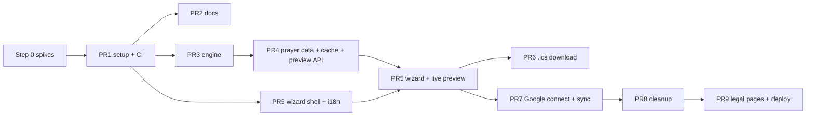

### Step 0: Spikes (before the code that depends on them)

1. Does `calendar.app.created` let us find our "Salat" calendar again later? If not, keep its ID in the browser and fall back to creating a new one.
2. Does updating a deleted event with the same ID bring it back? If not, add a version suffix to event IDs.
3. Calendar batch size limit, and whether a 155-event month fits one Worker request under the CPU limit. If not, use half-month chunks (`chunks.ts` takes the size as a parameter).
4. Google Identity Services token popup: incremental scopes and behaviour for an unverified app.
5. Google daily request cap and verification requirements, for section 5 and the README.
6. `caches.default` under OpenNext on Workers. If it does not work, use KV from the start.
7. Open-Meteo geocoding: timezone field name and fair-use number.

### PR 1: Setup and CI

- `git init`, create `hijri-js/salat-calendar`, `pnpm create next-app` (TypeScript, App Router, Tailwind, ESLint, `src/`), strict `tsconfig`.
- `.gitignore` (`.env*` except `.env.example`, `.wrangler/`, `.open-next/`, `node_modules/`, `coverage/`, `learning/`), `.env.example`, `LICENSE`.
- `dependabot.yml` (weekly: npm, github-actions); `ci-security.yml` (Gitleaks with `fetch-depth: 0`; frozen install, audit high, `tsc --noEmit`, lint, `test --run`).
- Vitest with 100% threshold on `prayer-engine`; `AGENTS.md`, `CLAUDE.md`; this plan as `docs/PLAN.md`.
- **Check:** CI green on the PR; no `package-lock.json` / `yarn.lock`.

### PR 2: Documents

- `PRD.md`: summary, problem, personas, feature matrix, competitor table (Fajr Calendar, Sutrah, Tuqaa, SalahSync, praycalendar, SALATI and other static `.ics` feeds), non-goals. Competitor facts are checked on the web; anything unconfirmed is marked "not verified".
- `ARCHITECTURE.md`: section 4 diagrams, chunked-sync explanation, capacity table, security.
- `BACKLOG.md`: epics → stories → acceptance criteria → tasks, including deferred items.
- `README.md`: what Salat is and how the five times follow the sun (with a sun-angle diagram), architecture overview, setup (section 8), tests, deploy.
- Style: plain English, short sentences, diagrams first.
- **Check:** every Mermaid block renders on GitHub; links resolve.

### PR 3: Engine

- `lib/prayer-engine/` with tests: parsing (`"04:32 (BST)"`), offsets across midnight, rounding in all three directions and both grids, window bounds and overnight windows, all four Jummah modes, OOO all-day vs overlap, EN/AR titles, London December vs June Maghrib against 08:00–16:00, DST weeks (London, New York, Riyadh with none).
- **Check:** coverage 100% lines/branches/functions for `prayer-engine`.

### PR 4: Prayer data, cache, preview API

- AlAdhan client + normaliser, local fallback, `TimingsCache`, `/api/prayers/preview`.
- Tests with recorded fixtures: cache hit, miss, "fallback is not cached", 429 handling.
- **Check:** `curl` the route for London and Riyadh; second call is served from cache.

### PR 5: Wizard and live preview

- `next-intl`, RTL layout, stepper with free navigation, six steps, defaults, validity marks, Zustand store, `WeekGrid`, `MiniPreview`, city search, GPS.
- Also in this PR: engine, fallback and schema fixes; preview API hardening; security headers; CI fixes; UI/UX restyle with native HTML elements and Lucide icons ([ADR 0001](adr/0001-native-ui-over-shadcn.md)).
- **Check (browser):** `/en` and `/ar`; jump between steps in any order; the "pick a city" reason is visible until a place is set, and the final buttons say "Coming soon" until PR 6 and PR 7 wire them; London + 08:00–16:00 with offset 0 hides Maghrib in June (21:20) and shows it in December (15:52) — with a +15 min offset December Maghrib starts at 16:07 and is correctly skipped too (the default offset is 0 since PR 6.5); "No Friday slot" removes Friday Dhuhr; keyboard-only pass; phone width has no sideways scroll.

### PR 6: `.ics` download

- `ics.ts` (pure, tested: line folding, escaping, UTC conversion across DST, fixed UIDs), download card.
- **Done:** `ics.ts` (PR 18); the download in PR 6: `icsFile.ts` (rolling-year window, month chunks, file name, engine → file; tested), `useIcsDownload.ts` (one cached preview request per month, so each stays inside the Worker limits and shows progress), `DownloadCard` on the Get it step.
- **Check:** import the file into Google Calendar and one other app; times match the preview on a DST-change week.
- **Import check, done by the owner (2026-11-20):** Google imported into the main calendar (it ignores the file's calendar name) and the file held all five prayers after the settings reset. Fixed in PR 6.2 (#22: import steps, "In the file: …"), 6.3 (#23: settings saved in the browser), 6.4/6.5 (#24, #25: real adhan times, events at the adhan by default) and 6.6 (#26: Prayers table, colour swatches).
- **PR 6.1 follow-up:** a day-based progress bar with a percentage on the download card; the server pauses AlAdhan for 30 s after a timeout or 5xx (not only after a 429), so an outage costs one 10 s wait instead of one per month; the file gains `METHOD:PUBLISH` and a growing `SEQUENCE`, so apps that match by UID update events on re-import.

### PR 7: Google connect and sync

- Prerequisites: Spikes 1–4 still open; tighten CSP (nonce or hashes) before handling tokens.
- Token popup, scopes from 4.7, `google-sync/server/*`, `/api/calendar/sync-month`, paced `useYearSync`, progress and summary UI.
- Tests: reconcile (insert/update/delete/replace-off), OOO parsing, chunk maths, batch encoding and partial failures, route validation, missing-token rejection.
- **Check (needs 8.1):** sync a year into a test account; sync again and get 0 created; change the offset and re-sync, events move; add a vacation event and those days are skipped.

### PR 8: Cleanup

- `/api/calendar/cleanup`, paged delete loop, confirm dialog, Disconnect (revokes the token).
- **Check:** "Remove all" leaves a hand-made event untouched and reports the right count.

### PR 9: Legal pages and deploy

- Privacy and terms pages (per-scope explanations), `wrangler.jsonc`, `open-next.config.ts`, deploy guide, `docs/VERIFICATION.md` (steps from 8.4, scope justifications, video script).
- Cloudflare per-IP rate-limit rule on `/api/prayers/preview`.
- **Check:** `opennextjs-cloudflare build` succeeds; `wrangler dev` serves the app; live URL works after adding it to the Google client.

### Review loop (every PR)

Before each PR is opened, an independent reviewer agent reads the diff for real bugs, security holes, and mismatches with this plan. I fix every high and medium finding and re-review until none remain. Then CI must be green.

### Subagents

Shared contracts (`prayer-engine/types.ts`, `sync/schema.ts`) are written first by me. After PR 1, three agents work in parallel in separate worktrees: docs (PR 2), engine (PR 3), wizard shell (PR 5 first half). PR 4, 6, 7, 8 follow in order because each builds on the last. One reviewer agent serves all PRs.

---

## 11. Risks

| Risk                                              | Handling                                                                    |
| ------------------------------------------------- | --------------------------------------------------------------------------- |
| 10 ms CPU limit on a 155-event month              | Measured in Step 0; chunk size is a parameter                               |
| Narrow scope cannot rediscover the Salat calendar | Step 0; fallback keeps the ID client-side                                   |
| AlAdhan down or rate limited                      | Cache + local fallback, flagged in the UI                                   |
| Google per-user limit (600/min) during sync       | One month at a time, pacing, backoff, per-month retry                       |
| Token readable by injected script                 | Strict CSP, single third-party script, 1-hour life, revoke on Disconnect    |
| Open-Meteo terms or fields differ from expected   | Step 0; fallback is search-on-Enter with Nominatim, which its policy allows |
| Competitor claims in `gemini-chat.md` are wrong   | Re-checked before going into the PRD                                        |

Sources for section 5: [Google Calendar quota](https://developers.google.com/calendar/quota), [Google Calendar usage limits](https://developers.google.com/calendar/pricing), [AlAdhan rate-limit FAQ](https://community.islamic.network/d/2-is-there-a-rate-limit-on-the-apis), [Nominatim usage policy](https://operations.osmfoundation.org/policies/nominatim/), [Open-Meteo geocoding](https://open-meteo.com/en/docs/geocoding-api).
