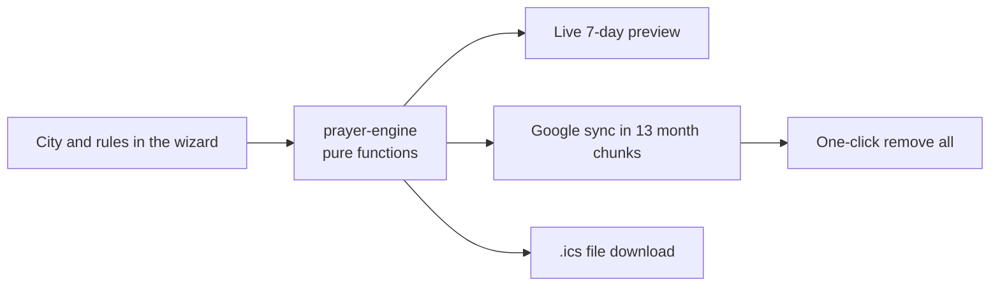
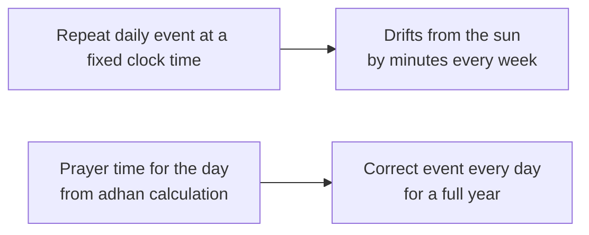
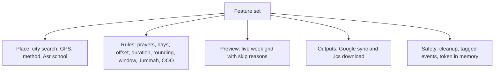
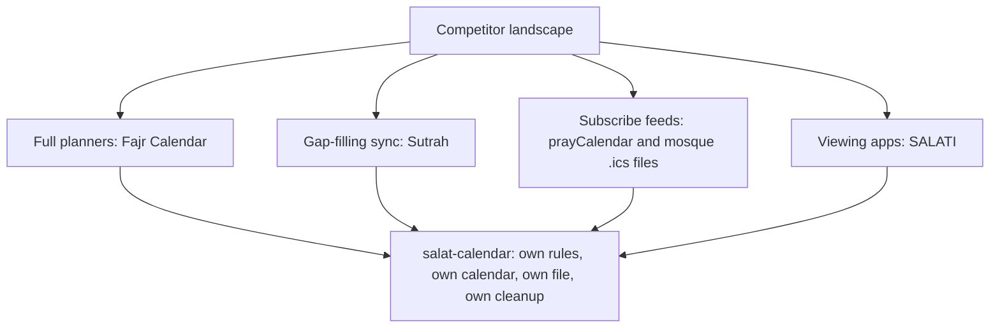

# salat-calendar — PRD

Source of truth: [docs/PLAN.md](./PLAN.md) (sections 1, 2, 5, 6, 10). This PRD changes no plan decision. Competitor facts were checked against live web pages during this session. Anything that could not be confirmed from a live page is marked **"not verified"**. No pricing or feature claim was invented.

## 1. Summary

salat-calendar is a web app that turns one year of prayer times into real Google Calendar events, or into a downloadable `.ics` file. The user picks a city and a few rules. The app does the rest in one pass.

Key facts, all from the plan:

- One year of prayer events in one run. Sync writes month by month, with a progress bar and a per-month retry.
- Every event is tagged `app=salat-calendar`. Cleanup touches only tagged events.
- The Google access token lives in browser memory for the tab only. It is never stored anywhere.
- No database. User rules live in browser memory. Event ownership lives on the events.
- Two locales: `/en` and `/ar`, with right-to-left layout for Arabic.
- Open source, Apache-2.0, repo `hijri-js/salat-calendar`. Deploys to Cloudflare Workers.

## 2. Problem

Prayer times shift a few minutes every day because they follow the sun. A calendar event that repeats daily at a fixed clock time is wrong within a week, and the drift compounds over the year.

Existing tools fall into two camps:

1. Mobile prayer-time apps. They show times well but do not write calendar events that a work calendar can respect.
2. Calendar feed services. They add events but with fixed rules, fixed durations, and no way to respect the user's work day or remove them cleanly.

salat-calendar covers both camps in one web app: real Google events with the user's own rules, plus a plain `.ics` file for calendars that only take files. It also cleans up after itself in one click. Among the competitors checked, only Sutrah states it touches only its own events. Subscribe feeds such as prayCalendar are removed by unsubscribing, not by the tool cleaning up.

## 3. Personas

The plan implies these users through its rules and wireframes (plan sections 1, 2, 6). They are personas, not marketing segments.

| Persona | Story | Needs the plan gives them |
| --- | --- | --- |
| Amira, office professional | Works 08:00-16:00 in London. Meetings land on her calendar all day. Wants prayers blocked as Busy inside her window, and Jummah as a fixed 12:30 slot. | Time window, Busy/Free choice, Jummah fixed-time rule, out-of-office skip |
| Bilal, Apple or Outlook user | Does not want to connect Google at all. Wants a file to import into Apple Calendar or Outlook, once a year. | `.ics` download with no login, fixed UIDs so re-import updates events (plan section 4.10) |
| Kareem, Arabic-speaking user | Reads the interface in Arabic, right to left, with prayer names in Arabic. | `/ar` route, RTL layout, Latin numerals, Arabic event titles |
| Samir, frequent traveller | Flies often. His out-of-office events should make the app skip those days automatically on Google sync. | OOO skip with an editable keyword list; all-day versus timed overlap handling |

## 4. Feature matrix

The features of salat-calendar itself, mapped to the build slices in plan section 10.

| Feature | Slice | Notes |
| --- | --- | --- |
| City search with timezone (Open-Meteo) and GPS detect | PR 5 | Type-ahead allowed by Open-Meteo policy; Nominatim rejected by the plan |
| Calculation method list, Asr school | PR 3, PR 5 | Method table adapted from the `salat-time` reference project |
| Enable or disable each prayer, per-prayer override | PR 3, PR 5 | Global default plus optional per-prayer offset, duration, Busy/Free |
| Weekday filter with presets | PR 5 | |
| Offset and duration, defaults plus per-prayer | PR 3 | Capped server-side: offsets within 180 min, duration 5-180 min |
| Rounding: off, or 5/10 minute grid, nearest/up/down | PR 3 | |
| Jummah: same as Dhuhr, fixed, custom, or none | PR 3 | Four modes, all engine-tested |
| Time window, including overnight windows | PR 3 | London 08:00-16:00 hides Maghrib in June and shows it in December |
| OOO skip on Google sync, editable keywords | PR 7 | All-day removes the day; timed removes overlapping prayers only |
| Event title, emoji, colour, reminder | PR 5, PR 7 | v1 extras per plan section 2 |
| Live preview with skip reasons | PR 5 | Mini preview on every step; full 7-day grid step |
| Google sync, month by month, paced | PR 7 | Rolling 12 months, retry per month, replace toggle |
| `.ics` download, no login | PR 6 | Fixed UIDs; no vacation skip by design |
| Remove all salat-calendar events | PR 8 | Paged delete, confirm dialog, personal events untouched |
| Privacy and terms pages, deploy | PR 9 | Built ready for Google verification (plan section 8.4) |

## 5. Competitor table

Method: each row states only what could be confirmed from a live page (product home page, pricing page, or GitHub README). Where a page was unreachable, JavaScript-only, or the product could not be located at all, the row says **not verified**. No pricing was invented.

| Product | What it does (verified where stated) | Pricing (verified where stated) | Overlap with salat-calendar | Where salat-calendar differs |
| --- | --- | --- | --- | --- |
| Fajr Calendar - fajrcalendar.com | Live site. AI Muslim planner: prayer times, tasks, habits, and meetings in one calendar. Syncs to Google Calendar, Outlook, iCloud, Slack, Teams. Auto-reschedules a prayer event that overlaps a meeting. Busy/Free setting, reminders, custom offset, calculation method and madhab picker. Includes a prayer-aware meeting finder tool. | Free plan exists. On the free plan, calendar sync is a subscribe link limited to 30 days. The pricing page FAQ states Premium is $1.99/month on the monthly plan. | High overlap: prayer events in Google Calendar with custom rules, windows around meetings, Busy/Free. | Fajr Calendar is a full planner with accounts and an AI layer. salat-calendar is a single-purpose, no-account, open-source tool with one-click remove-all. |
| Sutrah - sutrah.app | Live site. Prayer times in Google Calendar and Outlook, placed in real free gaps inside each prayer window, and moved when the day changes. Apple Calendar via a feed. Free, no card. Reads busy times only. Touches only events it created. Times from the open-source adhan library. States beta with 50+ beta testers. | Free (stated on site). | High overlap on the Google sync path, including gap-finding around meetings. | Sutrah optimises placement automatically. salat-calendar gives explicit, inspectable rules, a full-year preview, and cleanup. Sutrah is not open source. |
| Tuqaa | not verified. No live product page could be found. tuqaa.app and tuqaa.io were unreachable during the check; tuqaa.com returned an unreadable error page. A GitHub search found no prayer-calendar product by this name. | not verified | not verified | not verified |
| SalahSync - salahsync.com | The domain is live but is a "Coming soon" under-construction page. No product features could be verified. GitHub shows only unrelated hobby repositories named SalahSync. | not verified | Unclear. The plan (section 2) names SalahSync as a Google prayer-sync product; this could not be confirmed from any live page. | Once live, presumably a sync competitor. salat-calendar differentiators: full-year scope, inspectable rules, .ics output, cleanup. |
| prayCalendar - github.com/AhmedElywa/prayCalendar, live at pray.ahmedelywa.com | Open source, ISC licence. One-click subscribe feed for Google, Apple, and Outlook. 14+ calculation methods, alarms, selectable prayers, weekday filtering, custom duration 5-60 minutes, Ramadan mode, Jumah mode, busy status, Qibla in event descriptions, iqama offsets, Hijri dates. Six languages including Arabic with RTL. 45+ preconfigured cities, JSON API, embeddable widget, Home Assistant integration. | Free (stated in README). | High overlap on the feed path: prayer events with rules, durations, weekday filters, Jumah handling, busy status, Arabic RTL. | prayCalendar is a subscribe feed: rules are fixed at subscribe time and updates flow from the provider. salat-calendar is user-driven, syncs into a dedicated calendar, offers out-of-office skip, and provides one-click removal. |
| SALATI - salati.app | Live site. A mobile app (App Store and Android links on the site) for prayer times with a live countdown, the full Quran with translation and recitation, Qibla, Athkar, Hijri and Gregorian dates. Free, no ads, core features offline. | Free (stated on site). | Low: it is a prayer-times app, not a calendar-sync product. Any Google Calendar sync claim: not verified. | salat-calendar writes calendar events. SALATI is an app for viewing and reading. |
| Other static .ics feed services | Category row. Many mosque and community websites publish static or subscription .ics prayer feeds. Specific services beyond prayCalendar were not surveyed: not verified. | Unknown per service: not verified. | Partial: some are static yearly files, some are subscription feeds. | salat-calendar combines user-chosen rules, a live preview, Google sync with OOO skip, a downloadable .ics file, and self-service cleanup in one place. |

### Reading the table

The plan (section 2) already anticipated the name conflict with SalahSync and chose the name salat-calendar partly because of it. That decision stands. The current state of salahsync.com does not contradict the plan.

## 6. Non-goals

These are decisions from plan sections 2, 4, and 5. They are not missing features; they are deliberate rejections.

- No accounts and no database. Rules live in browser memory. Ownership lives on the event tags. A database is only needed for accounts or automatic monthly re-sync, and both are backlog items (see docs/BACKLOG.md).
- No token storage of any kind: no cookies, no localStorage, no server storage, no logs, no refresh token. If this makes the product less convenient, it stays that way.
- No server-side trust of client times. The server reads prayer data and writes Google events; it does not act on times sent by the client.
- No Nominatim geocoding. Its policy bans autocomplete and allows 1 request/second for the whole app. Open-Meteo is used instead.
- No PWA, service worker, gradients, or countdown page. Explicitly left behind from the salat-time reference project.
- No yearly single-request sync. One year in one Worker request exceeds the free CPU and call limits; sync is month-by-month by design.
- No untagged event writes. Sync and cleanup only ever touch events tagged app=salat-calendar.
- No vacation skip in the .ics file. A file cannot read the user's calendar; the UI states this trade-off plainly.

## 7. Conflicts

None. Every statement above was checked against docs/PLAN.md. The competitor landscape has moved since the plan was written: salahsync.com is currently a placeholder page, and no Tuqaa product could be located. Neither fact contradicts a plan decision, because the plan's name choice does not depend on SalahSync being live.
